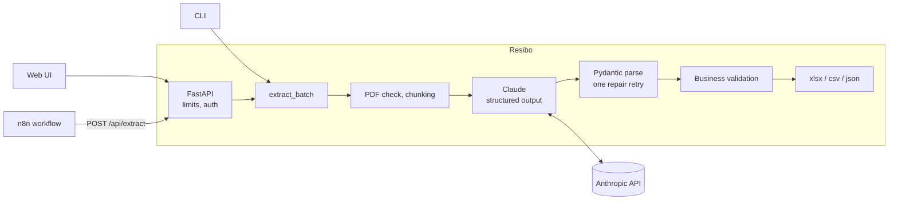

# Resibo

**Turn a PDF of invoices and receipts into a clean, validated spreadsheet.** Resibo ("receipt" in
Filipino) reads every page with the Anthropic API, then Python checks the numbers and flags
anything a person should look at.

**Live demo:** TODO: add the Railway URL after deploy (human step 10)

[](https://github.com/OWNER/ocr-receipts/actions/workflows/ci.yml)
<!-- TODO: replace OWNER with the GitHub account that hosts the repo -->


<!-- TODO (human step 13): record docs/demo.gif -->

## What it does

- Finds every invoice and receipt in a multi-page PDF (several per page, or one across pages)
  and returns one row per document plus its line items.
- Checks the data instead of trusting it: totals, VAT, duplicates, missing fields, dates, TINs
  and the model's own uncertainty become flags, and each row gets an OK, REVIEW or ERROR status.
- Exports a formatted Excel workbook (3 sheets) and CSV files, over a web page, an HTTP API or an
  n8n workflow that watches a Google Drive folder.

It is for bookkeepers, finance teams and BIR-compliant Philippine businesses that still key
invoices in by hand.

## How it works



1. **Upload.** A PDF arrives through the page, the API or the CLI. Resibo checks it is really a
   PDF (magic bytes), not encrypted, within the page and size limits.
2. **Claude reads the PDF.** The file is sent in chunks of 10 pages as a document block. Each
   chunk is told its page range so page numbers stay in the original numbering.
3. **Structured output returns schema-valid JSON.** The request uses `output_config.format` with
   a fixed JSON schema: no regex over free text. An invoice cut by a chunk boundary is re-read
   whole.
4. **Python validates.** Pydantic checks the structure (one repair retry), then deterministic
   rules check the arithmetic and set each document's status. The model reads; Python decides.
5. **Excel and CSV.** Results are kept in memory for 60 minutes and exported as `.xlsx`, an
   invoices CSV and a line items CSV (UTF-8 with BOM so Excel shows the peso sign correctly).

**Why structured outputs, not forced tool calls.** `claude-sonnet-5-5` rejects a forced
`tool_choice` and a non-default `temperature` with a 400. Structured outputs give the same schema
guarantee with less code, and the request sends neither.

**Cost controls for a public demo.**

- The **Try with sample invoices** button serves a committed, recorded result: no API call.
- Live runs are limited **per IP** (default 5 an hour). The client IP is read from the *right*
  of `X-Forwarded-For`, so a spoofed header does not reset the limit.
- A global **daily budget** (default $3 per UTC day) is reserved before every Claude call
  (chunks, halves and repairs) and replaced by the actual cost afterwards. When it is used up,
  public runs get 503 and the sample and keyed requests keep working.
- A model that is not in the price table is charged at the **highest known price**, so a
  mistyped `CLAUDE_MODEL` cannot disable the cap (the batch still shows cost as `null`).
- Requests with a valid `X-API-Key` (used by n8n) skip the public limits.

## Why it's trustworthy

Every rule is a pure function in `resibo/validation.py`, covered by tests. Money uses `Decimal`,
never float. Tolerance is ₱1.00 by default.

| Flag | Severity | What it means |
|---|---|---|
| `MISSING_REQUIRED` | error / warning | A field required for the document type is missing (one flag per field) |
| `TOTAL_MISMATCH` | error | Printed total is not within tolerance of the computed total (discount, withholding and VAT-inclusive layouts accepted) |
| `VAT_MISMATCH` | warning | VAT is not 12% of VATable sales |
| `LINE_ITEMS_MISMATCH` | warning | Line items do not add up to the document's figures |
| `LINE_ITEM_MATH` | warning | quantity x unit price is not the line amount |
| `DUPLICATE` | error | Same invoice number and seller as an earlier document |
| `POSSIBLE_DUPLICATE` | warning | Same seller, date and total, different number |
| `TIN_FORMAT` | warning | TIN does not have 9, 12 or 14 digits |
| `FUTURE_DATE` / `OLD_DATE` | warning | Invoice date is in the future, or over 5 years old |
| `DUE_BEFORE_ISSUE` | warning | Due date before the invoice date |
| `NEGATIVE_AMOUNT` | warning | A money field is below zero |
| `LOW_CONFIDENCE` | warning | The model listed fields it could not read confidently |
| `INCOMPLETE_DOCUMENT` | warning | The document seems to continue past the pages read |
| `SPLIT_ACROSS_CHUNKS` | warning | A very long document could not be read in one piece |

Examples of flag messages: `Computed ₱11,200.00 but document says ₱11,500.00`,
`Same invoice number and seller as INV-001`.

**Status:** any error flag gives `ERROR`; otherwise any warning gives `REVIEW`; otherwise `OK`.
Flagged rows are tinted, never hidden.

**Prompt injection.** Text in a document is treated as data: the system prompt says so, the model
can only answer with JSON matching the output schema, and every number is re-checked by Python.
Extracted text is inserted into the page with `textContent`, and exports prefix any cell that
starts with `=`, `+`, `-`, `@`, tab or CR with `'` so an uploaded PDF cannot plant a spreadsheet
formula.

## Accuracy

| Model | Fields correct | Time | Est. cost / page |
|---|---|---|---|
| claude-sonnet-5-5 | 114/114 (100%) | 22.5 s | ~$0.010 ($0.081 for 8 pages) |
| claude-haiku-4-5 | TODO | TODO | TODO |

The sample (`samples/sample-invoices.pdf`) has 8 pages and 8 documents built from fictional
businesses: a clean invoice, a 2-page service invoice with 18 lines, a receipt with a discount,
two receipts on one page, an invoice whose total is ₱300 too high, an exact duplicate, and a
rotated, low-contrast scan with a stamp. `samples/expected.json` is the ground truth the eval
scores against.

## Automation with n8n

Drop a PDF into a Google Drive folder and n8n sends it to Resibo, appends the rows to a Google
Sheet, emails a summary ("5 documents processed, 2 need review") and moves the file to
`Processed` or `Needs Review`. The exported workflow and the setup guide are in
[`n8n/README.md`](n8n/README.md).


<!-- TODO (human step 11): add a screenshot of the imported canvas -->

## API

Interactive docs are at `/docs`.

```bash
curl -F "file=@invoices.pdf" -H "X-API-Key: $KEY" https://<app>/api/extract
curl -F "file=@invoices.pdf" "https://<app>/api/extract?format=xlsx" -o invoices.xlsx
```

| Method | Path | |
|---|---|---|
| GET | `/` | Web UI |
| GET | `/health` | `{"status":"ok","model":"..."}`, makes no API call |
| GET | `/api/sample` | The bundled sample PDF |
| GET | `/api/sample/result` | The cached sample result (`cached: true`), 30 per minute per IP |
| POST | `/api/extract` | Multipart field `file`; `format=json` (default), `xlsx` or `csv` |
| GET | `/api/batches/{id}` | Batch JSON while it has not expired |
| GET | `/api/batches/{id}/export.xlsx` · `/invoices.csv` · `/line_items.csv` | Downloads |

Errors are always `{"error": {"code": "...", "message": "..."}}`. Codes: `NOT_A_PDF`,
`PDF_EMPTY`, `PDF_ENCRYPTED`, `PDF_UNREADABLE`, `UNAUTHORIZED`, `FILE_TOO_LARGE`,
`TOO_MANY_PAGES`, `RATE_LIMITED` (with `Retry-After`), `BATCH_NOT_FOUND`,
`SAMPLE_NOT_RECORDED`, `EXTRACTION_TRUNCATED`, `EXTRACTION_INVALID`, `UPSTREAM_REFUSED`,
`UPSTREAM_ERROR`, `DEMO_BUDGET_EXHAUSTED`, `INTERNAL`.

## Run locally

Run everything **from the repository root**: the app finds `samples/` from the working directory.

```bash
cp .env.example .env        # set ANTHROPIC_API_KEY (and RESIBO_API_KEY if you want keyed access)

# with Docker (Resibo on :8000, n8n on :5678)
docker compose up

# or with uv
set -a; source .env; set +a
uv run uvicorn resibo.api:app --port 8000
```

Open <http://localhost:8000>. The server refuses to start without `ANTHROPIC_API_KEY`; the
client is created lazily, so a placeholder key is enough to look at the page and the sample
(without a recording, **Try with sample invoices** shows "Sample result not recorded yet").

**CLI**

```bash
python -m resibo extract path/to/file.pdf -o out.xlsx          # Excel (default)
python -m resibo extract path/to/file.pdf -o out.csv --csv     # invoices CSV + line items CSV
python -m resibo extract path/to/file.pdf -o out.json --json   # the batch JSON
python -m resibo extract samples/sample-invoices.pdf -o out.xlsx \
    --record samples/sample-result.json                        # save raw model output (cached demo)
```

**Samples and eval**

```bash
python scripts/make_samples.py   # rebuilds samples/sample-invoices.pdf and samples/expected.json
python scripts/eval.py           # real API calls; scores the sample against expected.json
```

`samples/sample-result.json` is written **only** by a real `--record` run. It is never created by
hand or generated from `expected.json`, because the page labels it "a live run".

## Deploy to Railway

1. New project from the GitHub repo; Railway builds the `Dockerfile` (`railway.json` sets the
   health check `/health`).
2. Variables: `ANTHROPIC_API_KEY`, `RESIBO_API_KEY`, `CLAUDE_MODEL` (a model listed in
   `resibo/config.py` `PRICES`), `DAILY_BUDGET_USD`. Others default.
3. Generate a public domain and put it at the top of this README.
4. Confirm which `X-Forwarded-For` entry Railway appends: log the raw header once from two
   networks, set `TRUSTED_PROXY_HOPS` accordingly, then remove the log line.
5. Compare Railway's maximum HTTP request duration with your longest keyed run; if it is shorter,
   lower `MAX_PAGES`.
6. Set a monthly spend limit in the Anthropic Console as the last-resort safety net.

Run with one worker only: the store, rate limiter and budget are per process.

## Tests

No network and no API key are needed.

```bash
pip install ".[dev]"        # or: uv run --extra dev ...
ruff check . && ruff format --check .
pytest -m "not live"
```

`pytest -m live` runs one optional smoke test against the real API when `ANTHROPIC_API_KEY` is
set. CI runs lint, format check and the offline tests on Python 3.12.

## Project structure

```
resibo/            package: config, models, schema, prompts, pdf_utils, validation, llm,
                   extractor, exporters, store, ratelimit, sample, api, __main__, static/
samples/           sample-invoices.pdf, expected.json (generated), sample-result.json (recorded)
scripts/           make_samples.py, eval.py
n8n/               workflow JSON and setup guide
docs/              architecture.md
tests/             one module per core module, plus API, CLI, UI, packaging and n8n checks
```

See [`docs/architecture.md`](docs/architecture.md) for the layering and the decisions behind it.

## Limitations and roadmap

**Known limitations (v1)**

- PDF only; no direct photo upload.
- Results, rate limits and the daily budget live in memory: one instance, one worker, and a
  restart clears them.
- Chunks are processed one after another.
- An invoice longer than `PAGES_PER_CHUNK` pages may be split (flagged `SPLIT_ACROSS_CHUNKS`).

**Ideas for v2**

- Image uploads (JPG, PNG, HEIC from a phone).
- "Ask your invoices": results in Postgres with pgvector and an agent that can query them.
- Push to Zoho Books, Xero or QuickBooks as draft bills.
- A review screen to correct flagged fields, with corrections saved as eval data.
- Concurrent chunk processing and the Anthropic Batch API for large backlogs.
- Per-field confidence and bounding-box highlights.

## Built by

Jan Terence Francisco. TODO: add profile links.
Built with Claude Code via DCTerminalv2.

Released under the [MIT License](LICENSE).
