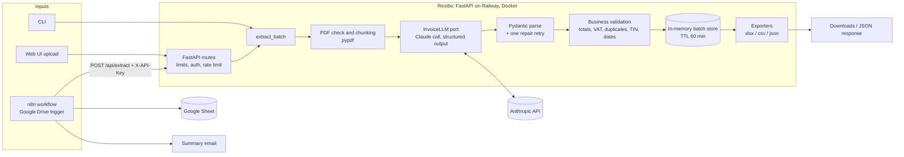
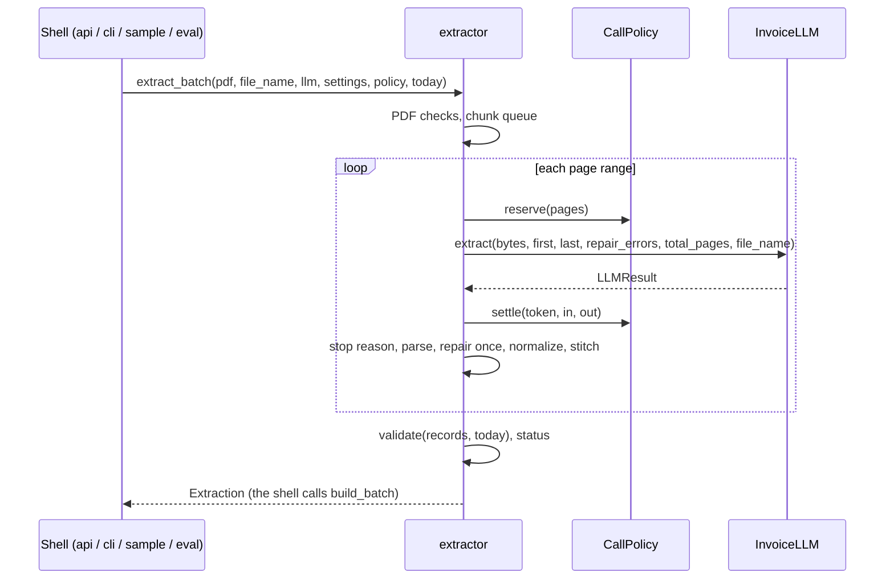

# Resibo architecture

Functional core, imperative shell. The core is synchronous Python: PDF bytes in, typed records
and file bytes out. Claude is reached only through the `InvoiceLLM` port, so every test runs
offline with `FakeLLM` or `ReplayLLM`. Shells (HTTP API, CLI, eval, the cached sample) own I/O,
clocks, limits and state, and all call one entry point, `extractor.extract_batch`.

## Layers

| Layer | Modules |
|---|---|
| Core: data | `resibo/models.py`, `resibo/schema.py`, `resibo/prompts.py`, `resibo/config.py` |
| Core: pipeline | `resibo/pdf_utils.py`, `resibo/extractor.py`, `resibo/validation.py`, `resibo/exporters.py` |
| Port and adapters | `InvoiceLLM` and `AnthropicLLM`, `RecordingLLM` in `resibo/llm.py`; `ReplayLLM` in `resibo/sample.py`; `FakeLLM` in `tests/helpers.py` |
| Shell: service | `resibo/api.py`, `resibo/store.py`, `resibo/ratelimit.py`, `resibo/sample.py`, `resibo/static/` |
| Shell: tools | `resibo/__main__.py`, `scripts/make_samples.py`, `scripts/eval.py` |

Rules a test enforces (`tests/test_architecture.py`): core modules never import `fastapi`,
`starlette`, `anthropic` or a shell module; only `llm.py` imports `anthropic`; only `config.py`
reads the environment.

## One extraction

Halves (after truncation) and repairs go through the same `reserve`/`settle` pair, so the daily
budget covers every Claude call. The public policy allows one halving level and one repair.

## Decisions that are easy to miss

- **Structured outputs, not forced tool calls**: `claude-sonnet-5-5` rejects `tool_choice` and
  non-default `temperature`, so the request uses `output_config.format` with a fixed schema.
  The schema in `resibo/schema.py` equals SPEC.md section 8.7 and is never generated.
- **Recording format v1** (`RecordingLLM`): one JSON file holding the raw model output per
  chunk. The cached sample replays it through the normal pipeline, so flags always reflect the
  current rules. Only a real `--record` run may write `samples/sample-result.json`.
- **Per-call context on the port**: `total_pages` and `file_name` are arguments of `extract`,
  not state on the adapter, because one `AnthropicLLM` serves concurrent requests.
- **Budget pricing**: a model missing from the price table is reserved at the highest known
  price, so the public cap cannot be disabled by a configuration typo.
- **CSP scope**: the strict content security policy applies to `/`, `/app` and `/static/*` only;
  FastAPI's `/docs` page needs an inline script and CDN assets.
- **Sample files** are found from the working directory (`samples/`; `/app/samples` in the
  image), never from the installed package location.
