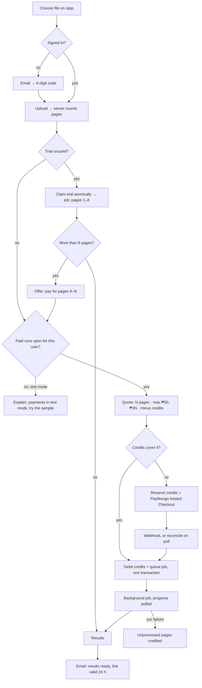

# PRD: Free trial, paid runs and image uploads

**Status:** Draft, revised after risk review · **Date:** 2026-11-24 · **Version:** 2.0
**Surface:**
- `resibo/api.py`, `resibo/config.py`, `resibo/models.py`, `resibo/extractor.py` and `resibo/pdf_utils.py`;
- new modules `resibo/accounts.py`, `resibo/billing.py`, `resibo/jobs.py` and `resibo/db.py`;
- `resibo/static/`, `Dockerfile` and `railway.json`;
- SPEC.md §7, §11 and §12.

**Depends on:** [prd-landing-and-carbon-ui.md](prd-landing-and-carbon-ui.md). Build this **after that PRD's wave 3**. W2 here replaces its limits text (L6) and adds to its landing page.

## Decisions

| # | Decision |
|---|---|
| P-D1 | Each verified email gets one free trial, covering at most 8 pages. A larger file is processed up to page 8, and the rest can be paid for. |
| P-D2 | After the trial, every run is paid, whatever its size. |
| P-D3 | Price: **₱3 per page, ₱50 minimum per run**. |
| P-D4 | Identity: sign in with a 6-digit code sent to the user's email. No passwords. |
| P-D5 | Gateway: **PayMongo** hosted Checkout. The methods are QR Ph, GCash and Maya; cards are off at launch. |
| P-D6 | **Test mode is allowlist-only.** While `PAYMONGO_MODE=test`, only emails in `PAYMENTS_ALLOWLIST` can create paid quotes. Anyone else gets the trial and the cached sample. In test mode, anyone can complete a checkout with simulated money, so an open test mode would be free extraction on the owner's Anthropic bill. |
| P-D7 | The gateway sits behind a small interface, so a Maya Checkout adapter can be added later without touching the payment flow. |
| P-D8 | No per-run page limit for paid runs, apart from a **safety cap of 300 pages**. |
| P-D9 | Uploads accept PDF, JPG and PNG. Each image counts as 1 page. |
| P-D10 | Runs that fail on our side (upstream or internal errors) are credited back as **page credits**, which never expire. A money refund is available on request (Refund policy), done by hand. Validation ERROR rows are results, not failures, and are not credited. A failed **trial** run only resets the trial and never creates credits. |
| P-D11 | The cached sample stays free, needs no sign-in, and costs nothing. Requests with `X-API-Key` (the owner and the n8n workflow) are unmetered and do not change. |
| P-D12 | `resibo.essentoph.com` (Cloudflare DNS, **DNS only**) hosts the app and sends the email. |

## Summary

Today anyone can run 15 pages, 5 times an hour, paid from the owner's $3/day budget. This release replaces that with a one-time 8-page free trial per verified email and paid runs after it. Payment is ₱3/page with a ₱50 minimum, through PayMongo QR Ph, GCash or Maya. Paid runs run as background jobs that survive restarts, and uploads now accept phone photos. In test mode, paid runs are limited to an allowlist.

## Unit economics (option A)

Assumes ₱58 = $1. Each margin is the price minus Claude cost, the payment fee and the 3% percentage tax. If the business is VAT-registered, use 12% VAT instead.

| Item | Per page | Source |
|---|---|---|
| Claude Sonnet 5.5, measured | ~₱0.58 ($0.010) | README eval: $0.081 for 8 pages |
| Claude, worst case | ~₱1.30 ($0.022) | `reservation_cost` in `resibo/ratelimit.py:122`, for a 10-page call: 3,000 input tokens per page plus the full 16,000-token output |
| Claude, worst case for a 1-page run | ~₱9.60 | Same formula, 1 page |
| PayMongo fee | QR Ph 1.50%, GCash 2.50%, Maya 2.00% (12% VAT included) | PayMongo published rates, 2026; check before going live |

| Run | Price | Claude, worst case | Fee (GCash) + 3% tax | Margin, worst case | Margin, measured |
|---|---|---|---|---|---|
| 1 page | ₱50 | ₱9.60 | ₱2.75 | ~75% | ~93% |
| 17 pages | ₱51 | ₱22.10 | ₱2.81 | ~51% | ~75% |
| 100 pages | ₱300 | ₱130 | ₱16.50 | ~51% | ~75% |
| 300 pages | ₱900 | ₱390 | ₱49.50 | ~51% | ~75% |

Fixed costs are a Railway service with a volume (about $5–20 a month) and the email sender's free tier. A trial costs about ₱10.

## Non-goals

- Card payments (3.125% + ₱13.39 plus VAT is about a third of a ₱50 payment). Revisit them for runs of ₱200 or more.
- Subscriptions, prepaid packs, coupons and invoicing for companies.
- Automatic money refunds through the PayMongo API.
- Passwords, social login and team accounts.
- Changing validation. The extractor changes only as E1 describes.
- Charging for the cached sample, or for keyed (`X-API-Key`) requests.
- Taking real money. That needs the owner's DTI and BIR registration and PayMongo activation (see Human steps).

## User flow



## Detailed design

### Identity (`resibo/accounts.py`)

- `POST /api/auth/code {email}` sends a 6-digit code.
  - The code is stored as a hash and is valid for 10 minutes. It allows 5 attempts.
  - **Limits, kept in SQLite so they survive restarts:**
    - 3 codes per email per hour and 6 per day;
    - 10 per IP per hour;
    - a **global cap of `EMAIL_DAILY_CAP=80` emails a day**, below Resend's free-tier 100. The owner gets an alert at 80% of the cap. Above it, sign-in shows "Sign-in is busy, try again later" and keeps the 202 response shape.
  - The response is always 202, so it doesn't reveal whether an account exists.
- `POST /api/auth/verify {email, code}` checks the code, creates the user if new, and sets the session cookie.
  - The cookie is `resibo_session`: random, stored as a SHA-256 hash, `HttpOnly; Secure; SameSite=Lax`, with no `Domain` attribute, valid for 30 days.
- `POST /api/auth/logout` ends the session. `GET /api/me` returns the email, whether the trial is used, page credits, whether paid runs are open for this user, and recent jobs.
- Emails are normalised: trimmed and lowercased. For `gmail.com`, dots and `+tags` are removed. Disposable email domains are refused, using a list kept in the repo.
- **CSRF:** state-changing requests that carry the session cookie must send an `Origin` equal to `PUBLIC_URL`.
  - **Exempt:** `POST /api/webhooks/paymongo`, which is authenticated by its signature, and requests with a valid `X-API-Key`. Neither sends `Origin`.
  - `SameSite=Lax` adds a second layer.
- **Email sender:** behind `EmailSender`. Resend is the default, using the verified domain `resibo.essentoph.com`. In tests, `FakeEmailSender` collects the messages.

### Trial

- **Claiming the trial is atomic:** `UPDATE users SET trial_claimed_at = now WHERE id = ? AND trial_claimed_at IS NULL`. Exactly one request can see a row count of 1. The claim happens in the same transaction that queues the trial job.
- A trial job that fails on our side clears `trial_claimed_at`. It never writes credits.
- **Abuse limits, kept in SQLite:**
  - **5 trials per IP per 24 hours**, using the rightmost `X-Forwarded-For` entry (existing `TRUSTED_PROXY_HOPS`). The limit is per day, not per month, because Philippine mobile carriers put many users behind one shared IP.
  - The disposable-domain block.
  - `DAILY_BUDGET_USD` (existing, $3) covers trial runs only. When it runs out, trials pause with `DEMO_BUDGET_EXHAUSTED`.
- A trial run of a file with more than 8 pages processes pages 1–8. The results screen then offers "Pay ₱N for pages 9–M". Below the minimum that is ₱50.

### Spend caps

| Cap | Covers | Default | When reached |
|---|---|---|---|
| `DAILY_BUDGET_USD` | Trial runs | $3.00 | Trials pause (`DEMO_BUDGET_EXHAUSTED`) |
| `PAID_DAILY_BUDGET_USD` | Paid runs (Claude cost) | $20.00 | New quotes are refused with `PAID_RUNS_PAUSED` (503) **before payment**. Jobs already paid always run. |
| Per-job cost cap | One job | 3× the job's expected cost at the measured rate | The job stops. Pages not read are credited, and the owner is alerted. |

All caps are reserved and settled with the existing `DailyBudget` logic (reserve the worst case, settle the actual), per call.

### Quote and payment (`resibo/billing.py`)

- `POST /api/quotes` (multipart: one PDF, or **at most 50** JPG/PNG files, enforced in the parser) works as follows:
  1. Normalise the upload into one PDF (see Uploads).
  2. Count the pages and check the 300-page cap.
  3. Store the file on the volume.
  4. Return `{quote_id, pages, price_centavos, credits_applied, amount_due_centavos, expires_at}`.
  - It refuses with `PAYMENTS_NOT_OPEN` (403) when paid runs are not open for the user (P-D6), and with `PAID_RUNS_PAUSED` (503) when the paid cap is reached.
- Price: `max(MIN_CHARGE_CENTAVOS, PRICE_PER_PAGE_CENTAVOS × pages)` = `max(5000, 300 × pages)`. Credits are worth 300 centavos per page.
- **Quote states:** `open → checkout_open → paid → queued → running → done | failed`, plus `expired` and `payment_review`.
  - An `open` quote expires after 60 minutes.
  - Creating a checkout moves it to `checkout_open` and extends the file's lifetime to 24 hours.
  - **The sweep never deletes the file of a quote in `checkout_open`, `paid`, `queued`, `running` or `payment_review`.**
- **Credits are reserved, not just shown.** When checkout is created, or when credits alone cover the run, a `quote_applied` debit row goes into `credit_ledger` in the same SQLite transaction as the state change. If the quote expires unpaid, a `quote_released` row reverses it. With the debit already written, a second open quote can't spend the same credits.
- `POST /api/quotes/{id}/checkout` creates a PayMongo Checkout Session and returns its URL. The session has:
  - one line item, "Resibo extraction · N pages";
  - `payment_method_types: ["qrph", "gcash", "paymaya"]` (check these identifiers against PayMongo's current docs);
  - `send_email_receipt: true`;
  - success and cancel URLs on `https://resibo.essentoph.com/app?quote=…`;
  - metadata with `quote_id`.

  When a `checkout_open` quote expires unpaid (after 24 hours), the server expires the PayMongo session through the API before releasing the credits.
- **Webhook** `POST /api/webhooks/paymongo` handles `checkout_session.payment.paid`:
  - Verify the `Paymongo-Signature` header: HMAC-SHA256 over `t.payload` with `PAYMONGO_WEBHOOK_SECRET`, compared in constant time, using `te` in test mode and `li` in live mode.
  - **Timestamps are not rejected by age.** PayMongo retries can carry an old timestamp, and replays are harmless because handling is idempotent.
  - In one transaction:
    1. Insert into `payments` with **UNIQUE(checkout_session_id)**. A duplicate is a no-op.
    2. Check that the amount and currency equal the quote's `amount_due_centavos` in PHP.
    3. Move the quote to `paid` and queue the job.
  - **On an amount or currency mismatch, or an unknown quote:** store the payment, move the quote to `payment_review`, email the owner, return 200 and do not run the job. The owner resolves it by refunding by hand or queuing the job.
  - Unknown event types return 200.
- **Reconciliation when a webhook is missed** (for example during a deploy):
  - While the success page polls `GET /api/quotes/{id}`, if the quote is still `checkout_open`, the server fetches the checkout session from PayMongo at most once every 10 s. If it's paid, the server runs the same transaction as the webhook.
  - A sweep every 5 minutes does the same for every `checkout_open` quote.
- **The browser is never trusted to say it paid.**
- **Interface:**

  ```python
  class PaymentGateway(Protocol):
      def create_checkout(self, quote: Quote, return_url: str) -> Checkout: ...
      def fetch_checkout(self, checkout_id: str) -> CheckoutStatus: ...
      def expire_checkout(self, checkout_id: str) -> None: ...
      def verify_webhook(self, headers, raw_body: bytes) -> PaidEvent | None: ...
  ```

  `PayMongoGateway` is the only adapter. Tests use `FakeGateway`.

### Extractor changes (`resibo/extractor.py`), story E1

Today `extract_batch` reads chunks one after another (`extractor.py:202`). Any chunk error raises and throws away the chunks already read (`extractor.py:101-153`, `209`). Stitching depends on the previous chunk (`_restart_page`, `extractor.py:219`). Jobs need three things it doesn't do:

1. **A per-chunk outcome.** `extract_batch` gains a mode in which a chunk that fails with an upstream or internal error is recorded as `failed_pages` instead of raising. The returned `Extraction` carries `failed_pages: list[int]`, and the batch shows those pages in a "Pages not read" note in the UI and every export. The keyed `/api/extract` call keeps today's raise-on-error behaviour.
2. **Concurrency that keeps stitching correct.**
   - **First pass:** read the planned chunks with up to `JOB_CHUNK_CONCURRENCY` (default 3) calls at once.
   - **Second pass, in order:** where a chunk ends in a partial invoice (`_restart_page` returns a page), re-read from that invoice's first page to the end of the first invoice in the next chunk, then apply today's discard rule.
   - **Required test:** on every existing extractor fixture, concurrent and sequential mode produce identical batches.
3. **Resumable progress.** Each finished chunk's result is saved to the job's folder on the volume (`/data/jobs/<id>/chunk-<first>-<last>.json`). A restarted job reuses the saved chunks.

**Replay compatibility:** the cached sample replays recorded calls keyed by `(first_page, last_page, repair)` (`resibo/sample.py`). The keyed and sample paths keep today's sequential mode, so `samples/sample-result.json` keeps replaying unchanged. It must not be re-recorded (Non-goals of the UI PRD).

**`CallPolicy` for trial and paid runs:**
- `max_halving_depth=2`;
- one repair per chunk;
- the per-job cost cap above.

Today's keyed policy allows unlimited halvings and repairs; keyed runs keep it.

**Chunks also have a byte budget.** A chunk is cut at whichever comes first: the page count, or **20 MB** of PDF bytes. This keeps every request well under the Anthropic Messages API's 32 MB limit after base64, which matters now that uploads can be 50 MB of scans.

### Background jobs (`resibo/jobs.py`)

- `jobs` table: `queued → running → done | failed`, with `attempts`, `pages_done`, `pages_total`, `failed_pages`, `batch_id`, `error_code` and `owner_user_id`.
- One worker thread in the single uvicorn process runs one job at a time, with chunks running concurrently as E1 describes. Trial and paid jobs share the queue, and trial jobs (8 pages or fewer) are taken first so a big paid job never blocks a trial for 15 minutes.
- `GET /api/jobs/{id}` returns status, progress and the queue position. The UI polls every 2 s. When a job finishes, the user gets an email with a link valid for 24 hours. The email never contains extracted data.
- **Restarts** (each Railway deploy restarts the service):
  - On startup, a `running` job goes back to `queued` with `attempts + 1` and resumes from its saved chunks.
  - **After 2 attempts, the job fails.** For a paid job, the unread pages are credited; for a trial, the trial is reset. A job that crashes the process can't loop forever.
- **Results** are stored on the volume for 24 hours, then deleted with their source file and chunk files. The in-memory LRU `BatchStore` stays for keyed requests and the sample.
- **Owner check by user, not session:** a batch, job or quote is returned only to a session whose `user_id` owns it. The emailed link therefore works on any device after sign-in.

### Uploads and images (`resibo/pdf_utils.py`)

- Uploads are recognised by their first bytes, never by file extension: `%PDF-`, the JPEG `FF D8 FF` marker and the PNG signature. Anything else is refused with `UNSUPPORTED_FILE`.
- **Before decoding:** read the image size from its header. Anything over **50 megapixels** is refused with `UNSUPPORTED_FILE` ("Image too large"). `Image.MAX_IMAGE_PIXELS` is set to 50 million, so Pillow refuses decompression bombs as well.
- **Each image becomes one PDF page:**
  - EXIF orientation is applied;
  - PNG transparency is flattened onto white;
  - the image is **scaled down to a 2,000 px long edge** (smaller images are left as they are);
  - it is **re-encoded as JPEG quality 85**.

  A typical phone photo becomes 300–700 KB, which keeps chunks small and is still more than Claude reads (Claude downsizes large images anyway). Images are added in upload order.
- **Upload limits:**
  - `MAX_QUOTE_UPLOAD_MB=50`, applied to `POST /api/quotes` by extending `UploadLimitMiddleware`, which today checks only `/api/extract` (`resibo/api.py:112-116`).
  - `MAX_UPLOAD_MB` stays 20 for the keyed `/api/extract`.
  - Each image is limited to 10 MB.
- Pillow moves from the dev dependencies to the runtime dependencies (see "Tests that change").

### Storage (`resibo/db.py`)

- SQLite on a Railway volume mounted at `/data` (`DATABASE_PATH=/data/resibo.db`), using the standard library `sqlite3`:
  - **one connection per thread** (the request threads and the job worker thread);
  - `PRAGMA journal_mode=WAL` and `PRAGMA busy_timeout=5000`.
- It is safe because the app runs as **one** uvicorn worker (AD-20, `resibo/api.py:4`). Moving to several workers would require Postgres.
- Tables: `users`, `login_codes`, `sessions`, `rate_counters`, `quotes`, `payments`, `jobs`, `credit_ledger`.
  - Page credits are the sum of `credit_ledger`, never a field that gets overwritten.
  - Ledger reasons: `job_failed` (+), `paid_file_expired` (+), `owner_adjustment` (±), `quote_applied` (−) and `quote_released` (+).
  - Every money or credit change happens in one transaction with the state change it belongs to.
- Schema migrations are numbered SQL files in `resibo/migrations/`, applied at startup inside a transaction.
- **Backups:** a daily `VACUUM INTO /data/backups/resibo-YYYY-MM-DD.db` keeps 7 days. The owner also turns on Railway volume backups if the plan offers them, because the ledger records money owed.
- **Volume permissions:** Railway volumes are typically mounted owned by root, while the image runs as `USER resibo` (uid 10001, `Dockerfile:21`).
  - The fix: an entrypoint script, run as root, that only does `chown -R resibo:resibo /data` and then `exec setpriv --reuid=10001 --regid=10001 --init-groups uvicorn …`. The app never runs as root.
  - At startup the app writes and deletes a probe file in `/data`. If that fails, it exits with the log line "DATA_DIR not writable", so the problem doesn't show up as a crash loop.
  - Verify the volume ownership on the first Railway deploy.

### API and contract changes (SPEC.md §7, §11)

New routes:
- `POST /api/auth/code`, `POST /api/auth/verify`, `POST /api/auth/logout`, `GET /api/me`;
- `POST /api/quotes`, `GET /api/quotes/{id}`, `POST /api/quotes/{id}/checkout`;
- `GET /api/jobs/{id}`;
- `POST /api/webhooks/paymongo`.

`GET /api/batches/{id}` and the downloads also serve volume-stored batches, with the owner check.

`Batch` gains `failed_pages: list[int]`, which is empty unless E1's partial mode left pages unread.

New error codes:

| Code | HTTP |
|---|---|
| `AUTH_REQUIRED` | 401 |
| `CODE_INVALID` | 400 |
| `CODE_EXPIRED` | 400 |
| `EMAIL_NOT_ALLOWED` | 400 |
| `TRIAL_LIMIT_REACHED` | 403 |
| `PAYMENTS_NOT_OPEN` | 403 |
| `PAYMENT_REQUIRED` | 402 |
| `PAID_RUNS_PAUSED` | 503 |
| `QUOTE_NOT_FOUND` | 404 |
| `QUOTE_EXPIRED` | 410 |
| `JOB_NOT_FOUND` | 404 |
| `UNSUPPORTED_FILE` | 415 |

`NOT_A_PDF` stays for the keyed `/api/extract`. `TOO_MANY_PAGES` means more than 300 pages on quotes.

New settings, in `Settings` and `.env.example` (`test_env_example_names_equal_settings_fields` enforces this):
- `PAID_MODE` (bool, default false; see Rollout);
- `PAYMONGO_MODE` (`test` | `live`), `PAYMONGO_SECRET_KEY`, `PAYMONGO_WEBHOOK_SECRET`, `PAYMENTS_ALLOWLIST` (comma-separated emails);
- `PRICE_PER_PAGE_CENTAVOS=300`, `MIN_CHARGE_CENTAVOS=5000`, `TRIAL_PAGES=8`, `MAX_PAGES_PAID=300`;
- `JOB_CHUNK_CONCURRENCY=3`, `PAID_DAILY_BUDGET_USD=20.00`, `MAX_QUOTE_UPLOAD_MB=50`;
- `EMAIL_DAILY_CAP=80`, `RESEND_API_KEY`, `EMAIL_FROM`, `OWNER_ALERT_EMAIL`, `PUBLIC_URL`, `DATABASE_PATH`.

`PUBLIC_MAX_PAGES` and `PUBLIC_RATE_LIMIT_PER_HOUR` are removed in **wave 3 only**.

### UI (`resibo/static/`)

- `/app` choose file → if not signed in, a two-step email/code form in the upload panel → upload → quote card ("18 pages · ₱54 · Pay with QR Ph, GCash or Maya") → PayMongo → back to `/app` with a progress bar ("Reading page 40 of 120", plus "2nd in line" when queued) → results.
- **Test mode:** the quote card says "Payments are in test mode. No real money is charged." For users not on the allowlist, it reads "Paid runs open soon. Your free trial and the sample are available now."
- **Free trial:** the card reads "Your free trial: first 8 pages". After a trial run of a longer file, a red band reads "Pages 9–20 not read · Pay ₱50 to finish". Exports carry the same "Pages not read" note, so a partial batch is never mistaken for a complete one.
- The account menu in the masthead shows the email, page credits and sign out.
- The recorded-sample line keeps "Recorded run · <date>". Its button becomes **Try it on your own file**, which opens the file picker. This replaces "Run it live now" from UI PRD A5.
- The limits text (the `LIMITS_TEXT` constant and both HTML copies, UI PRD L6) becomes: "First 8 pages free, once. Then ₱3 per page (₱50 minimum). Files are sent to Anthropic for reading and deleted after 24 hours."
- The landing page gets a short pricing block under the tally, using the same text.
- The CSP stays unchanged. PayMongo Checkout is a top-level navigation, not a loaded resource, so `default-src 'self'` does not block it. No PayMongo script is loaded.

## Domain and DNS (essentoph.com on Cloudflare)

- **App:** `resibo.essentoph.com` is a CNAME to the Railway service, added as a custom domain in Railway. `PUBLIC_URL=https://resibo.essentoph.com`.
  - **The record must be DNS only (grey cloud), not proxied.** With the Cloudflare proxy on, Railway sees Cloudflare's IP as the rightmost `X-Forwarded-For` entry. Every visitor would then share one IP for the rate limits, the trials-per-IP rule and the budgets (`client_ip` in `resibo/ratelimit.py`, `TRUSTED_PROXY_HOPS`).
  - If the proxy is wanted later, a separate story must read `CF-Connecting-IP`, and only from Cloudflare's published IP ranges.
- **Email:** `EMAIL_FROM="Resibo <no-reply@resibo.essentoph.com>"`. Verify `resibo.essentoph.com` in Resend and add its SPF, DKIM and return-path records in Cloudflare (Cloudflare does not proxy MX or TXT records). Add DMARC at `_dmarc.resibo.essentoph.com`, starting with `p=none`, so sign-in codes don't land in spam.
- **PayMongo:** the webhook URL is `https://resibo.essentoph.com/api/webhooks/paymongo`.
- **Session cookie:** host-only on `resibo.essentoph.com`, so other `essentoph.com` sites never receive it.

## Tests that change

Rule (as in the UI PRD): replace each assertion with its new equivalent. Never delete one without a replacement, and never weaken one to make it pass.

| Test | Today | After | Story |
|---|---|---|---|
| `tests/test_config.py:34` (`test_settings_defaults`) | `s.public_max_pages == 15` | Assert `trial_pages == 8`, `max_pages_paid == 300`, `paid_mode is False` and `paymongo_mode == "test"`. `max_pages == 30` stays. | W2 (wave 3) |
| `tests/test_packaging.py` `test_env_example_names_equal_settings_fields` | Current fields | Passes with the new fields added to `.env.example`, all with empty secret values. | each story that adds a setting |
| `test_env_example_holds_no_secret_values` | Two keys empty | Also `PAYMONGO_SECRET_KEY`, `PAYMONGO_WEBHOOK_SECRET` and `RESEND_API_KEY` empty. | P2, S2 |
| `test_dockerfile_workdir_samples_user_and_healthcheck` | `USER` is not root and comes before `CMD`; no `pillow` | The entrypoint is checked instead: the script only chowns `/data` and then runs uvicorn as uid 10001 through `setpriv`; nothing else runs as root. Pillow is allowed as a runtime dependency; `[dev]`, `reportlab` and `--extra dev` stay forbidden. | S1, U1 |
| `test_dockerfile_cmd_is_shell_form_exec_uvicorn_single_worker` | Shell-form `CMD exec uvicorn … --workers 1` | Same checks, applied to the line in the entrypoint that runs uvicorn. | S1 |
| `test_dockerignore_keeps_what_the_build_needs` | Current list | Also keeps `resibo/migrations`. | S1 |
| Tests that call unkeyed `/api/extract` (`tests/test_api.py`) | 200 for unkeyed calls within the limits | With `PAID_MODE=false`, unchanged. With `PAID_MODE=true`, unkeyed calls get 401 `AUTH_REQUIRED`. Both are tested. | W2 |
| `tests/test_static.py` `LIMITS_TEXT`, labels | UI PRD text | The new limits text and "Try it on your own file". | W2 |

## User stories

### Epic S: Storage and accounts
- **S1 SQLite store, migrations, volume and entrypoint (M).**
  - The tables above, migrations at startup, the sweep, daily backups, and the writable-volume probe.
  - The entrypoint fix for the root-owned volume, and one connection per thread with WAL and `busy_timeout`.
  - Tests run on a temp database.
- **S2 Email code sign-in (M).**
  - A code expires after 10 minutes and allows 5 attempts.
  - The per-email, per-IP and global email caps are kept in SQLite.
  - The response is always 202.
  - Normalisation and the disposable-domain block apply.
  - The cookie has the flags above.
  - The Origin check applies, with the webhook and keyed requests exempt.
  - `FakeEmailSender` is used in tests, and nothing leaves the machine (`conftest.py` already blocks sockets).

### Epic E: Extractor
- **E1 Partial results, concurrency, byte budget, resumable chunks (L).** Everything in "Extractor changes".
  - Concurrent and sequential mode give identical batches on all fixtures.
  - `samples/sample-result.json` still replays unchanged.
  - A failed chunk produces `failed_pages` in partial mode and raises in keyed mode.

### Epic U: Uploads
- **U1 Images as pages (M).**
  - Files are recognised by their first bytes.
  - Images over 50 MP are refused before decoding.
  - Images are scaled down to a 2,000 px long edge and re-encoded as JPEG quality 85.
  - EXIF orientation and PNG transparency are handled.
  - 50 images make a 50-page PDF in upload order.
  - Each chunk stays at or under 20 MB.
  - The upload limit middleware covers `/api/quotes`.

### Epic P: Pricing and payment
- **P1 Quotes and credits (M).**
  - The price follows the formula, and quotes move through the states above.
  - Credits are reserved with a `quote_applied` row and released on expiry.
  - Two open quotes can never spend the same credits; this is tested with two requests at once.
  - The 300-page cap applies.
  - The allowlist (P-D6) and `PAID_RUNS_PAUSED` checks happen before any payment.
- **P2 PayMongo checkout, webhook and reconciliation (M).**
  - Signature: a bad signature returns 400 and changes nothing.
  - Duplicates and replays are no-ops (UNIQUE session id).
  - A mismatch leads to `payment_review` and an owner alert, with no job.
  - Reconciliation runs on poll and in the 5-minute sweep.
  - The PayMongo session is expired when its quote expires.
  - Only QR Ph, GCash and Maya are offered.
  - Tests use recorded test-mode payloads with a test secret.
  - One `live`-marked test creates a real test-mode session and is skipped without `PAYMONGO_SECRET_KEY`.
- **P3 Trial (S).**
  - The claim is atomic; two requests at once can't both get it.
  - The limit is 5 trials per IP per 24 hours, kept in SQLite.
  - An 8-page partial run is followed by the "pay for the rest" quote.
  - A failed trial resets the trial and creates no credits.

### Epic J: Jobs
- **J1 Job runner (M).**
  - One worker, with trial jobs first.
  - Progress and queue position are reported.
  - On restart, a job resumes from its saved chunks, with at most 2 attempts.
  - Failed pages are credited.
  - The per-job cost cap applies.
  - Results are stored for 24 hours, with the owner check by user.
- **J2 Results email (S).** It is sent on done or failed and carries the batch link. It never contains extracted data.

### Epic W: Web
- **W1 Sign-in, quote and progress screens (M).** All of it in Carbon, with `textContent` only. The test-mode and allowlist messages, and the "Pages not read" band.
- **W2 Switch-over (S).**
  - The `PAID_MODE` flag, pricing copy and the `LIMITS_TEXT` change.
  - Removing `PUBLIC_MAX_PAGES` and `PUBLIC_RATE_LIMIT_PER_HOUR`.
  - SPEC.md §7, §11 and §12.
  - The test changes listed in "Tests that change".

## Rollout

- **Waves:**
  1. S1, S2, U1, E1. No visible change. E1 runs behind the sequential default.
  2. P1, P2, P3, J1, J2. New routes exist but the UI does not use them. `PAID_MODE=false`, so unkeyed `/api/extract`, the 15-page limit and 5 runs/hour keep working for today's UI (`resibo/static/app.js:409`).
  3. W1, W2. The UI moves to sign-in, quotes and jobs. The deploy sets **`PAID_MODE=true`**, which turns unkeyed `/api/extract` into 401 and removes the old limits.
- **Rollback:** set `PAID_MODE=false`, or redeploy the previous commit. The database stays, and migrations only add tables.
- **Release notes:** the n8n workflow keeps working unchanged, because it uses `X-API-Key`.

## Requirements

### Non-functional
- **Security:**
  - No secret in the repo; secrets come from env only.
  - Webhook signatures are checked in constant time.
  - Codes and session tokens are stored only as SHA-256 hashes.
  - Every job, quote and batch route checks the owner by `user_id`.
- **Privacy:**
  - Files, chunk results and batches are deleted after 24 hours.
  - The privacy notice names the processors (Anthropic, US; Resend; PayMongo) and says that invoices can contain TINs and other personal data.
  - Emails are used only for sign-in, result notices and owner alerts.
- **Reliability:**
  - Webhook handling is idempotent and reconciled.
  - Jobs resume after restarts with at most 2 attempts.
  - Money and credit changes are made in one transaction.
  - The database is backed up daily.

## Human steps (owner)

1. In Cloudflare, add `resibo.essentoph.com` as a CNAME to the Railway domain, **DNS only (grey cloud)**, and add it as a custom domain in Railway.
2. Create a PayMongo account and get the **test** keys. Add a webhook pointing to `https://resibo.essentoph.com/api/webhooks/paymongo` for `checkout_session.payment.paid`. Set `PAYMONGO_SECRET_KEY`, `PAYMONGO_WEBHOOK_SECRET`, `PAYMONGO_MODE=test` and `PAYMENTS_ALLOWLIST` (your email) in Railway.
3. Create a Resend account and verify `resibo.essentoph.com`: add the records Resend shows, plus DMARC, in Cloudflare. Set `RESEND_API_KEY` and `OWNER_ALERT_EMAIL`.
4. Add a Railway volume mounted at `/data`, and turn on volume backups if your plan has them. On the first deploy, confirm the "DATA_DIR not writable" check passes.
5. Publish Terms, a Privacy notice (naming Anthropic, Resend and PayMongo as processors, plus the 24-hour retention) and a Refund policy (credits by default, money refunds on request for failed runs). PayMongo asks for these at activation.
6. **Before real money:**
   - register the business (DTI and BIR COR), submit PayMongo activation, switch to live keys and set `PAYMONGO_MODE=live`;
   - re-check PayMongo's fees and the tax treatment (3% percentage tax or VAT);
   - set up issuing BIR receipts for sales;
   - consider registering with the National Privacy Commission, since TINs are personal data under RA 10173;
   - this is not legal advice: confirm with an accountant.

## Success metrics

| Metric | Target | How measured |
|---|---|---|
| Trial → paid conversion (once live) | Baseline first; aim for ≥ 5% | Users with a paid quote ÷ users with a trial |
| Paid runs completed without a credit | ≥ 98% | `jobs` table |
| Gross margin per run, after fees and tax | ≥ 50% | Measured `estimated_cost_usd` vs amount paid |
| Payment-to-job-start time | p95 < 10 s when the queue is empty (queue wait reported separately) | Logs |

## Risks

- **Trial farming with throwaway emails.** Mitigated by the domain block, 5 trials per IP per day, the global email cap and the $3 trial budget. The worst case is the trial budget per day.
- **The single process is a scaling limit.** One job at a time with 3 chunks at once. Past that: Postgres and a separate worker service; the job table is already shaped for that.
- **The test-to-live gap.** Live activation depends on the owner's registration. Until then paid runs are allowlist-only, and the UI says so.
- **E1 is the riskiest code change.** The concurrent stitching must equal the sequential result. The identical-batches test across all fixtures is the gate, and keyed and sample paths stay sequential.
- **Claude price or model changes** move the margin. `PRICES` in `resibo/config.py` and the margin metric show it.
- **Anthropic rate limits** on 300-page jobs. `JOB_CHUNK_CONCURRENCY` is a setting, and paid runs use bounded retries and halving.
- **Deploys during a job** cost one resume each, not a full re-run, because finished chunks are saved.

## Resolved questions (2026-11-24)

| Question | Answer |
|---|---|
| What happens to "Run it live now" on the sample in `/app`? | It becomes **Try it on your own file** (W1). |
| Do page credits expire? | **No.** |
| What domain does Resibo use? | **`resibo.essentoph.com`** (Cloudflare DNS, DNS only). |
| How is test mode opened to the public? | It isn't. Paid runs are **allowlist-only** in test mode (P-D6). |
